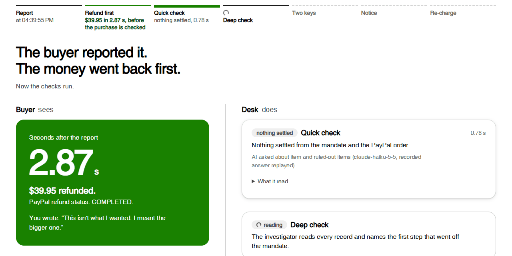
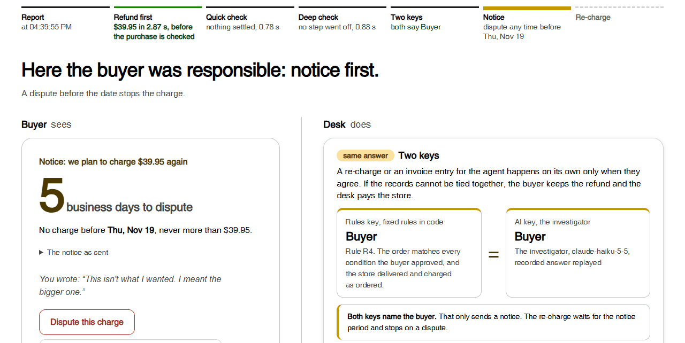

# Refund-First Desk

**Trust the buyer first. If that was wrong, give notice and take it back.**

**Demo: https://refund-first-desk.onrender.com** (PayPal sandbox)



*The refund comes first: PayPal's refund status is COMPLETED 2.87 s after the report, while the deep check is still reading the records.*



*Then the two keys: fixed rules in code and the AI investigator (here a recorded answer replayed) both name the buyer, so the buyer gets a notice and 5 business days to dispute before the saved wallet is charged again.*

**For judges, four steps on the demo** (the case in the two screenshots):

1. Open the demo. It runs on Render's free plan: if you see a Render loading page, wait and refresh; waking up can take up to about two minutes.
2. Pick *Order matches what the buyer approved*, press **Approve these conditions**, then **Let the agent shop and pay**.
3. Press **Report it**. The refund completes in seconds, then the quick check, the deep check and the two keys run.
4. Both keys name the buyer, so a notice comes first. Press **Fast-forward the notice period**: the saved sandbox wallet is charged again, never for more than was refunded.

**To watch a live AI agent instead** (live Claude, no recorded answers): under **Watch a live AI agent shop**, pick *Coffee maker, $45 limit*, press **Approve these conditions**, then **Run the hasty agent**. If it pays, press **Report it**. It is a live model, so the same instruction can end differently from run to run, including not paying at all. Live runs have a daily cap shared by all visitors ([limits](#a-live-agent-that-really-shops)).

When an AI shopping agent buys the wrong thing, PayPal refunds the buyer within seconds, before the purchase is checked. The records are checked afterwards. If the check finds the buyer responsible, the buyer gets a notice and 5 business days to dispute; after that, the saved PayPal wallet that paid is charged again, never for more than was refunded. In every other outcome the buyer keeps the refund.

1. **Refund first.** PayPal's refund status is COMPLETED before the purchase is checked (within the limits; sandbox runs 1.99–3.19 s).
2. **Then check.** The AI's verdict and fixed rules in code; after the refund, a re-charge or an agent invoice happens on its own only when they agree. If the records cannot be tied together, the buyer keeps the refund and the desk pays the store from its own funds.
3. **Take it back, only if the buyer was responsible.** Notice, 5 business days to dispute, then the wallet that paid is charged again.

The desk also has:

- A live agent that really shops. Claude takes the buyer's instruction, shops a small catalog we wrote one tool call at a time, and pays from the saved sandbox wallet if it decides to. The investigator reads that numbered log the same way it reads the prepared cases ([more](#a-live-agent-that-really-shops)).
- A case book, and a limit set by the buyer's own record. Every finished case goes into a case book that shows whoever runs the agent which condition it broke, and at which step. The buyer's instant-refund limit moves with that buyer's own past cases, by fixed rules in code; the AI never sets it ([more](#the-case-book-and-the-buyers-limit)).

The refund can come first because it can be taken back. The buyer saved the wallet with consent at purchase, the most they can be charged again is fixed at purchase, they get notice and can dispute, and a re-charge happens on its own only when the AI and the rules agree. PayPal's own buyer protection terms already allow a temporary refund during a dispute, recovered after at least 5 business days' notice if the dispute goes against the buyer ([Purchase Protection Program](https://www.paypal.com/us/legalhub/paypal/buyer-protection), updated 2026-01-26). The desk applies the same pattern to purchases made by AI agents, by rule, and before the check.

Other entries in this hackathon also check agent purchases against what the buyer approved. On 2026-11-09 we found 217 public GitHub repositories by search (16 search terms, repositories updated after 2026-10-01; the hackathon's Devpost gallery was not public then) and read the READMEs of the 211 that had one. Among them we found none that refunds before the check and then has a step to take the money back from the buyer.

Built on PayPal Orders v2, Payments v2 (refunds), saved PayPal wallets (Vault) and Payouts, in the PayPal sandbox. Claude reads the purchase records, finds the first step where the agent went off what the buyer approved, and gives its own verdict. Fixed rules in code give a second verdict. A re-charge or an agent invoice happens on its own only when the two agree; otherwise a person decides. When the records cannot be tied together (rule R0), the buyer keeps the refund and the desk pays the store from its own funds.

## The problem

A buyer tells an agent "compare prices, don't buy yet", and the agent buys. Or it picks the 750 ml bottle when the buyer asked for 500 ml. Today the buyer has to contact the seller, open a dispute, escalate it and answer requests for documents. PayPal says it usually reaches a decision within 14 days, but some cases can take 30 days or longer ([PayPal Help: How long does it take to resolve a dispute or claim?](https://www.paypal.com/us/cshelp/article/how-long-does-it-take-to-resolve-a-dispute-or-claim-help257)). An item that arrived as described, but was not what the buyer asked the agent for, may not be covered at all.

## Try the demo

The demo runs in the PayPal sandbox. To keep it fast and its AI bill bounded, the prepared cases replay Claude's recorded answers from our live runs. Wherever the screen names the model (the header, the quick check, the deep check and the AI key), it adds "recorded answer replayed". If you edit the buyer's sentence before pressing **Report it**, the deep check calls Claude live for that case.

To watch a real agent make the purchase first, use **Watch a live AI agent shop** at the top of the page. Pick an instruction (or write your own), approve the conditions, and run the **careful** or the **hasty** agent. Claude shops a small catalog we wrote, one tool call per step, and pays from the saved sandbox wallet if it decides to. Then report the purchase in one sentence, as below. See [A live agent that really shops](#a-live-agent-that-really-shops).

1. Or pick a prepared case, approve the buyer's conditions, let the agent pay, then press **Report it**. No sign-in is needed: the agent pays from a sandbox wallet saved earlier. Good cases to start with:
   - *Asked for a cart link, the agent checked out*: the quick check closes it in seconds.
   - *Shipping and tax took the total over the limit* or *Four ordered and charged, three shipped* (under **Show all 30 cases**): the order is over the $50 instant-refund limit, so the check comes first and the refund follows.
   - *Agent picked navy instead of black, then the store sent red*: in our runs the two keys disagreed here and a person decides. The live AI may answer differently on another run.
   - *Order matches what the buyer approved*: the buyer was responsible, gets a notice, and is charged again after it.
2. Each visitor gets a separate workspace. A buyer starts with **$50 a case and 2 instant refunds per 30 days**, and the buyer's own record moves both (see [the buyer's limit](#the-case-book-and-the-buyers-limit)). If you run *Order matches what the buyer approved* to the end (fast-forward, charged again), the limit drops to $25 and 1 instant refund, which is already used, so every later purchase in that workspace is checked first. If instead two cases were the agent's fault, a $58 purchase is refunded first. To start over, press **Start a fresh workspace** (top right).
3. For the buyer-responsible outcome, press **Fast-forward the notice period** to skip the 5-business-day notice; the saved wallet is then charged again.
4. The server runs on Render's free plan. After a quiet spell, the first page load can take up to about two minutes while it wakes up; if you see a Render loading page, refresh.

The **Pay at PayPal and save the wallet** button shows how the wallet gets saved in the first place. On this screen we tested it only as far as PayPal's sign-in page and back through Cancel. Approving at PayPal, capturing the payment and saving the wallet were tested with the same PayPal calls in a separate test script on 2026-11-09, not through this screen. To try it, you need your own PayPal sandbox personal account, signed in at `sandbox.paypal.com` first.

## How it works

Trust the buyer first: the refund comes before the check. If the check finds the buyer responsible, the desk gives notice and takes the money back; otherwise the buyer keeps it. Good news reaches the buyer fast; bad news comes slowly, and with notice.

```
buyer: one sentence ─► "Refund requested" ─► limits check ─► PayPal refund COMPLETED (seconds)
                                                                   │
        quick check: mandate + PayPal order only ◄─────────────────┤  a clear mismatch closes the case
                                                                   │  at once: "you will not be charged again"
        deep check (the investigator): mandate, the agent's ◄──────┤  names the first step where the agent
        numbered action log, PayPal order, store record            │  left the mandate, quoting that step
                                                                   │
        two keys: fixed rules in code   +   the AI's own verdict ──┤
                     same answer ─► re-charge, store payout or     │
                                    agent invoice (the refund stays)
                     different    ─► a person decides; nothing is charged or paid out meanwhile
```

Over the instant-refund limit ($50 a case, or more than 2 instant refunds in 30 days), the order flips: the checks run first and, when the buyer is not responsible, the refund follows within 5 minutes (longer if a person has to decide).

If PayPal accepts a refund but leaves it pending, the desk looks it up again, and the refund never closes a case or pays a store until PayPal reports it completed. If PayPal refuses a refund (for example, because the desk's PayPal balance is short), the case falls back to "check first" and the buyer is told so.

| Responsible | Buyer | Store | Money |
|---|---|---|---|
| Store (did not ship or charge what was ordered) | keeps the refund | not paid for this order | none |
| Agent (order differs from what the buyer approved) | keeps the refund | paid from the desk's own funds | agent operator owes the desk |
| Records cannot settle it | keeps the refund | paid from the desk's own funds | desk absorbs it |
| Buyer (order matches every approved condition) | notice → 5 business days → charged again on the saved wallet, never for more than was refunded | paid from that money | none |

The buyer can dispute during the notice period, or withdraw consent; either one stops the charge for good.

Pieces of this exist in other entries to this hackathon: checking the purchase against a mandate, searching for the first deviation, holding or cancelling a payment before it settles, refunding once a verdict is in, an operator making the store whole, moving money only when checks agree, and rules, then AI, then a person. What we did not find in the READMEs of those 217 repositories (GitHub search, 2026-11-09) is this order with this last step: refund first, then check, then take the money back from the buyer, after notice, and only if they were responsible.

### What the AI does, and what it never does

- **Does:** in the quick check, it compares the mandate with the PayPal order, and it can only close a case in the buyer's favour. In the deep check, it reads all four records and answers seven yes/no/unknown questions: was paying allowed, right item, right quantity, within the spending limit, nothing excluded, store charged as ordered, store shipped as ordered. It names the first step where the purchase went off the mandate, and gives its own verdict. Every yes/no answer and every first-step answer must quote the record it came from.
- **Never:** decides whether to refund, moves money on its own verdict, or overrides the rules. Its verdict is one of two keys.
- **How separate the two keys are:** the rules key works from the same seven facts. Code computes up to four of them itself from the mandate and the PayPal order (payment permission, spending limit, store charged as ordered, and quantity when the order holds one item), and its answer replaces the AI's for those. The other three (right item, nothing excluded, store shipped as ordered) come from the AI's quoted answers. So the keys are not independent. They catch a verdict that does not follow from the facts, and a fact that code can compute, but not a wrong answer that the AI backs with a real quote.
- **Guards:** a quote that is not found in the cited record turns the answer into "unknown". The buyer's own report is never accepted as proof. Totals and the payment permission are computed by code and override the AI. Any open question resolves in the buyer's favour. When the keys differ, a person decides. Text inside the records that tries to instruct the checker is treated as data (three of the prepared cases contain such text).

Here, "spending limit" is the buyer's cap on the order total in the mandate. The "instant-refund limit" is the desk's limit on refunding before the check.

### The case book and the buyer's limit

Every case the desk finishes goes into a case book below the cases on screen, written for whoever runs the agent. For each agent, it counts the conditions the agent broke at its own steps (paid without permission, wrong item, wrong quantity, over the spending limit, included something ruled out) as bars, coloured by who was finally found responsible, with the quoted log line of one case for each. For each store, it counts the store's own findings. A visitor's workspace holds only a few cases, so the screen can also show the book **after our 30 measured cases**: one measured run (PayPal sandbox, live Claude, 2026-11-10) on cases written by us. In that run the agent first left the mandate at its own step in 15 cases (wrong item 7; the other four conditions 2 each), and the store at its own step in 5. These counts equal the answer key (`test/casebook.test.js`). The 30 prepared cases carry no agent name, so they form one agent; an order that names its agent (`order.agent`) is grouped under that name.

The buyer's record also moves the instant-refund limit for the next purchase, by fixed rules in code (`src/domain/trust.js`). The AI never sets it.

- **Up:** for each earlier case of the same buyer that was the agent's or the store's fault (both keys agreed, or a person chose): +$25 a case and +1 refund, for at most two cases.
- **Down (the only rule that lowers it):** for each earlier case where this buyer was found responsible and was charged again with no dispute during the notice period: −$25 and −1 refund, down to a floor of $0 (every purchase is checked first). A verdict still inside its notice period does not count yet, because the buyer can still dispute it. A raise also lapses once its case is older than 180 days.
- Only that buyer's cases from the last 180 days count. The limit is fixed on the order at purchase, together with the cases that moved it, and the screen shows that reason under the purchase and in the buyer's "checking first" notice. Agents' and stores' records never move a buyer's limit.
- In the measured 30-case run each case has its own buyer, so no limit moved, and the money results are the same as before this rule (`scripts/loop.mjs --fake-paypal`, before and after).

### A live agent that really shops

In the 30 prepared cases, we wrote what the agent did. Here a real model does it. Claude (`claude-haiku-5-5`) gets the buyer's instruction and shops `scenarios/catalog.json` (written by us: 3 demo stores, 16 products, 4 prepared instructions) with six tools: search, product page, add to cart, remove, cart view, and checkout and pay. Each tool call is recorded as one numbered step, in the same format the investigator reads for the prepared cases. Payment goes through the same saved-wallet purchase (`POST /v2/checkout/orders` with `vault_id`); the store record and shipping are simulated. After that, the buyer's one sentence starts the same desk: refund first, quick check, deep check, two keys, and a re-charge only if the buyer was responsible.

**Why there are two agents.** An honest, careful agent usually buys the right thing, and then there is nothing to refund. So the page offers a second one. The two use the same model and settings, and differ in two ways only:

- **What it is told.** Careful: the approved conditions bind; open the product page of anything it adds; compare the cart total with the limit before paying; do not pay without permission. Hasty: it is an express-checkout agent graded on speed; pick from the top of the results and finish with payment.
- **What it can see.** Careful: the buyer's words and the approved condition slots; search results with store, variant and shipping; product pages and a cart view. Hasty: the buyer's words only; search results with product number, listing title and price; no product page and no cart view.

Neither agent is told to make a mistake, and no mistake is written in by code. It is a live model, so the same instruction can end differently from one run to the next. The catalog makes mistakes possible: a cheaper copy whose shipping and tax push the total over the limit, listing titles that hide the scent or the connector, multi-packs, and sponsored listings first. We changed the hasty agent once before measuring. At first its product numbers spelled out the variant (`SOAP-LAV`, `AAA24`) and it could open product pages, and it got 3 of 4 right. Product numbers became plain numbers, and the hasty agent lost the product page and cart tools.

On the hosted demo the live agent has limits: 15 runs a day for all visitors, 3 per workspace, 16 model calls per run, and the same overall AI spending cap as the checks, checked before every model call. The counts behind these limits are kept in a file on the server. The hosted demo runs on Render's free plan with no persistent disk, so that file is lost when the instance restarts, for example after it sleeps. The limits hold while the server stays up, and the counts start again from zero after a restart. The spending cap is checked against calls already recorded, so calls made at the same moment can take the total slightly past it (each call cost about $0.001 or less in our measurement).

## Who runs this

- **Today, on PayPal as it is:** a company that operates AI shopping agents runs the desk. It receives the purchase payment, refunds from it, and makes an innocent store whole from its own funds.
- **If PayPal ran it:** PayPal would hold the store's funds for the disputed order instead. Delayed disbursement already exists for approved partners.

## Measurements

### The 30 prepared cases

All runs used the PayPal sandbox and live Claude calls (`claude-haiku-5-5`, no recorded answers replayed). The table shows run 4, measured on 2026-11-12 at commit `7a3ebfb`. The demo page's "30 measured cases" view shows run 3 (2026-11-10, commit `8daedd6`, one case to a person), whose recorded answers the prepared cases replay. **We wrote the 30 cases, the agents' action logs and the answer key for this demo.** The answer key was fixed before the live AI first ran on these cases (SHA-256 of `scenarios/cases.json`: `5873cb94…447d`). Targets were written down before measuring. The per-case results behind this table, the abuse run and the live-agent run below are in [`docs/measurements/2026-11-12-summary.json`](docs/measurements/2026-11-12-summary.json), without account or order identifiers.

| What | Target | Result |
|---|---|---|
| What the buyer has to do | one sentence | one sentence |
| Report → PayPal refund status COMPLETED, within the limits | every run ≤ 60 s | 1.99–3.19 s (26/26) |
| Refund completed before the purchase was checked, within the limits | every case | 26/26 |
| Over the limits, buyer not responsible: report → refund COMPLETED | ≤ 5 min | 4.1–13.6 s (3/3); the buyer-responsible case got no refund (1/1) |
| Verdicts matching the answer key where both keys agreed | ≥ 27 of 30 | 28/30; S14 and S22 went to a person (keys disagreed), counted as wrong |
| First step where the agent left the mandate, matching the answer key | ≥ 27 of 30 | 29/30 (S28 answered "no step off"); 30/30 in runs 2 and 3. All after tuning the prompt twice on these same 30 cases (27/30, 25/28 and 27/30 before); 10/10 on 10 new hold-out cases, see below |
| Keys disagree: no re-charge, store payout or agent invoice; the refund stays; the case waits for a person | 0 such money moves | 0 (2 cases in the person queue; 3 deliberate disagreements in the tests) |
| Quick check closes a buyer-responsible case | 0 | 0 of 6 |
| Quick check closes the cases marked for it in the answer key | ≥ 90 %, all 7 that code alone can show | 12/12, 7/7 |
| Refund completed → "you will not be charged again" notice | ≤ 10 s | median 1.0 s, max 3.2 s (12/12); in run 1 after tuning, one notice took 13.5 s because a single AI reply was slow |
| Buyer charged again when responsible, from the saved wallet, buyer not present | confirmed by PayPal lookup | 4 of 4 (a 5th was stopped by the buyer's dispute) |
| Buyer charged again when not responsible | 0 | 0 |
| Failure and abuse conditions reproduced on the sandbox | no unconsented, duplicate or over-cap charge | 9/9 |
| Ledger equals PayPal lookups for the buyer, the store and PayPal's fees (the desk's own two accounts are not compared) | every order | 30/30 (30-case run), 10/10 (abuse run) |

Reported without a target: the two keys agreed on 93 % of cases (28/30); the deep check took 5.6–12.1 s (median 7.9 s); two simple rules ("the last step" and "the first pay or checkout step") found the first wrong step in 0/30 and 2/30 cases; the live AI cost about $0.0017 per case (from the 2026-11-10 run; the run 4 evidence file holds no cost figure).

How we got to the table, run by run (all on the same 30 cases and the same fixed answer key):

- Untuned prompt, three runs: first step 27/30, 25/28 and 27/30. The first sandbox run also had 2 cases stopped by sandbox errors (the desk's sandbox PayPal balance was short, so PayPal refused one refund and left two pending); we topped up the sandbox balance and ran again.
- The misses fell into three kinds: calling a store-only problem (seen only in the store record) a step, counting "opened checkout" instead of "paid" as the step, and not knowing when the records are too thin to tell. The answer key's rules for these were written before the AI first ran, but the prompt had not stated them. We added them to the prompt, and fixed one wording slip that a second run exposed (a store step that cancels after charging). **These numbers come after tuning on the same 30 cases.**
- Tuned prompt on the 30 cases: run 1 first step 29/30 (one notice at 13.5 s, see the line above); run 2 first step 30/30, and every line passed.
- After the store-payout and screen fixes (same prompt, same 30 cases): run 3 first step 30/30, verdicts 29/30 (S22 to a person), every line passed; refund 1.88–3.09 s (26/26), notice max 3.0 s, over the limits 3.3–13.2 s, ledger 30/30; abuse 9/9, ledger 10/10. Two earlier runs of this build did not finish. One hit a PayPal 503 on a lookup after the money had moved (S28). In the other, the desk's sandbox PayPal balance ran out, so PayPal left refunds pending (19 cases stopped). We topped up the sandbox balance before run 3.
- After merging the case book and the live agent (2026-11-12, same prompt, same 30 cases; each case has its own buyer, so no limit moved): run 4 first step 29/30 (S28 answered "no step off"; S28 has varied between runs before), verdicts 28/30 (S14 and S22 went to a person because the keys disagreed; for both the refund was kept, with no re-charge, store payout or agent invoice), every line passed; refund 1.99–3.19 s (26/26), notice max 3.2 s, over the limits 4.1–13.6 s, ledger 30/30; abuse 9/9, ledger 10/10. The table above shows this run.
- An outside reviewer (Codex) cross-checked the money paths (store payouts that fail, wait or lose their answer, the 30-day boundary, prepaid stores) three times. Every finding was fixed with a test that failed first. The six findings of the third check are confirmed by those tests only, with no fourth review.
- Hold-out: 10 new cases written by someone who had not seen the prompt, with the answer key fixed before any AI run (`scenarios/holdout.json`). The untuned prompt got 7/10 on the first step, missing exactly the three kinds above; the tuned prompt got 10/10 in three runs; verdicts were 10/10 in every run.

Not comparable side by side: PayPal's "usually within 14 days" is its [published guidance](https://www.paypal.com/us/cshelp/article/how-long-does-it-take-to-resolve-a-dispute-or-claim-help257) for real disputes; our seconds are sandbox measurements. "Refunded" means PayPal's refund status is COMPLETED. When the money appears depends on the funding source (PayPal balance the same day; bank or debit card about 5 business days; credit cards one or two statement cycles).

Failure and abuse conditions: the same order reported twice; the same refund request sent again; an amount over the per-case limit ($50); more instant refunds than allowed in 30 days (2); a buyer who withdrew save-for-later consent; a dispute during the notice period; records that cannot settle it; a re-charge above the amount fixed at purchase; a re-charge requested twice.

### The live agent

**Measured on 2026-11-12 in the PayPal sandbox, with live Claude for the agent and for the checks.** 12 runs, each with a fresh buyer: careful and hasty, 6 each, on the 4 prepared instructions. A live run has no answer key. For each paid run, we read the agent log and the PayPal order and wrote down who was responsible, after the purchase and before any report or check ran (the file's fingerprint was fixed first). Every run was then reported with the same sentence, "This is not what I asked the agent to buy." Targets were written before measuring.

| What | Target | Result |
|---|---|---|
| Paid runs that went purchase → report → refund → two keys → settle (re-charge when the buyer was responsible) → ledger check without an error | ≥ 90 % | 8/8 |
| Two keys agreed and matched the person's answer | ≥ 80 % of paid runs | 8/8 (5 buyer responsible, 3 agent responsible); none went to a person |
| Hasty runs that bought off the mandate | ≥ 3 of 6 | 3 of 6 (coffee maker $46.90 over a $45 limit, twice; a USB-C to Lightning cable at $21.02 when a USB-C to USB-C cable under $20 was asked for); the other 3 did not pay |
| Buyer charged again when the person's answer was not "buyer" | 0 | 0 |
| Ledger equals PayPal lookups | every finished run | 8/8 |
| AI cost of the whole measurement | ≤ $0.50 | $0.024 (agent 51 calls, $0.011; checks 13 calls, $0.013) |

Reported without a target: the careful agent paid 5 of 6 times, each purchase within every condition; in the 6th ("put it in the cart, don't pay") it did not pay. The hasty agent stopped without paying twice on the dish soap, because its listings did not state the scent, and once put AAA batteries in the cart when AA were asked for, without paying. Refund 2.06–3.77 s. In all 3 agent-responsible runs, the deep check named the first step off as the pay step (over the limit) or the add-to-cart step (wrong connector), with the quote found in that step; in the 5 buyer-responsible runs it named no step. An agent run took 3 to 6 model calls, about $0.001.

## What is simulated, and what is only true in the sandbox

- **Simulated:** shipping and returns; the store's records; waiting periods (a fast-forward button moves the policy clock only); the agent operator paying its invoice.
- **Written by us:** the 30 cases, the agents' numbered action logs, the store records and the answer key. For the live agent: the catalog, its stores and the 4 prepared instructions (the live agent's log is its own).
- **Fast-forward and the counting windows:** the 30-day instant-refund count and the 180-day record window compare the policy clock with the real time each case was reported. Pressing fast-forward several times moves only the policy clock, so in the demo earlier cases can drop out of those windows too early. Without fast-forward, as in real use, the two clocks are the same and this does not happen.
- **Payments and re-charges without a clear answer:** a capture PayPal reports as `PENDING`, or a payment whose answer was lost, stays "not confirmed". The desk never cancels it or sends a new payment; asking again looks it up at PayPal. Only a `DECLINED` or `FAILED` capture (or a `VOIDED` order) counts as "nothing was charged". A re-charge is handled the same way: until PayPal answers, it is recorded neither as charged nor as stopped, the store is not paid from the desk's own funds, and the ledger check does not call the order a match. The next fast-forward or ledger check asks again under the same request id. Only a clear refusal (HTTP 400, 401, 403, 404 or 422, or a declined or failed capture) stops it. The tests cover this with the in-memory PayPal stand-in, not the sandbox.
- **Sandbox only:** on live accounts, charging a saved PayPal wallet without the buyer present requires PayPal's approval (billing agreements / reference transactions).
- **Policy numbers are assumptions:** $50 per case, 2 instant refunds per 30 days, 5 business days' notice (the same notice period PayPal's buyer protection terms give before recovering a temporary refund). How a buyer's record moves the limit (±$25 and ±1 refund per case, at most two cases up, 180 days) is an assumption too, not based on measured abuse or loss data. All of these are settings in `src/config.js` (`POLICY_*`; the record rule is `POLICY_TRUST_*`).

## PayPal APIs used

| Step | Call |
|---|---|
| First purchase, buyer present, wallet saved for later | `POST /v2/checkout/orders` with `payment_source.paypal.attributes.vault.store_in_vault: ON_SUCCESS`, then `POST /v2/checkout/orders/{id}/capture` |
| Agent pays, buyer not present | `POST /v2/checkout/orders` with `payment_source.paypal.vault_id` |
| Refund first | `POST /v2/payments/captures/{id}/refund` (with `PayPal-Request-Id`), `GET /v2/payments/refunds/{id}` |
| Read the order back for the check | `GET /v2/checkout/orders/{id}` |
| Charge the buyer again | `POST /v2/checkout/orders` with `vault_id` |
| Pay the store | `POST /v1/payments/payouts`, `GET /v1/payments/payouts/{id}` |
| Consent withdrawn | `DELETE /v3/vault/payment-tokens/{id}` |
| Ledger check | `GET /v2/payments/captures/{id}` and the lookups above |

The mandate's SHA-256 fingerprint is written into the PayPal order's `custom_id`, so the check can show that the record it compares is the one kept before the purchase.

## Run it

Node 20 or later.

```bash
npm install
npm test                       # 189 tests against an in-memory PayPal stand-in
npm start                      # http://localhost:8787
```

Settings go in a `.env` file (one level above this folder, or in it):

```
PAYPAL_CLIENT_ID=...
PAYPAL_CLIENT_SECRET=...
DEMO_VAULT_ID=...              # a sandbox wallet that already gave save-for-later consent
AI_PROVIDER=anthropic          # or "fixture" for hand-written stand-in answers
AI_MODEL=claude-haiku-5-5
ANTHROPIC_API_KEY=...
STORE_PAYPAL_EMAIL=...         # optional: a sandbox business account that receives store payouts
```

Scripts:

- `node scripts/loop.mjs`: the cases end to end on the sandbox.
- `node scripts/abuse.mjs`: the failure and abuse conditions on the sandbox.
- `node scripts/ai-eval.mjs`: the AI on all cases, with no sandbox money moving.
- `node scripts/live-agent.mjs buy`, then `report <answers.json>`: the live agent, in two phases so the person's answer is written before the checks run. Add `--fake-paypal` for a run without sandbox money.

Live AI calls are capped per day and in total (`src/ai/budget.js`); on the hosted demo these counts start again after a restart (see [A live agent that really shops](#a-live-agent-that-really-shops)).

## Evidence

Measured on 2026-11-10 and 2026-11-12 with the scripts above. Each run writes a JSON file with every PayPal call, the ledger and the case records to `data/evidence/` (not committed, because it holds sandbox account identifiers). A summary of the 2026-11-12 runs without identifiers, with the SHA-256 of each source file, is committed as [`docs/measurements/2026-11-12-summary.json`](docs/measurements/2026-11-12-summary.json). Recorded answers from the live AI runs are in `scenarios/recorded/`, keyed by a hash of the records the AI read.

## License

MIT

The page's colour, spacing, corner and shadow values are copied by hand from [Astryx](https://github.com/meta/astryx) 0.7.14 (MIT); no Astryx file is loaded.
